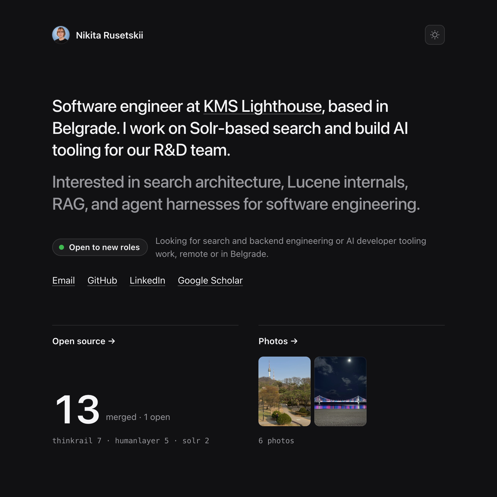

<h1 align="center">🌐 nikitar.dev</h1>

<p align="center">
  Personal site of Nikita Rusetskii: a one-page index with open source contributions and photos. Built with Nuxt 4, Tailwind CSS, and Nuxt Content.
</p>

<p align="center">
  <a href="https://github.com/xtenzQ/nikitar.dev/actions/workflows/deploy.yml">
    
  </a>
  <a href="https://github.com/xtenzQ/nikitar.dev/blob/master/LICENSE">
    
  </a>
  
  
</p>

<p align="center">
  
</p>

## ✨ Features

- 🗂️ One-page index: a short bio, open source pull requests, and photos in macOS-style grouped lists
- 🐙 Open source pull requests pulled from the GitHub API at build time and refreshed by a daily rebuild: the newest on the home page, all of them on `/oss` (curate them in `app/app.config.ts`)
- 📷 Photos: a featured set on the home page, all of them grouped by trip on `/photos`, with a native `<dialog>` viewer
- 🧹 Photo pipeline (`pnpm photos`): downscales originals and strips EXIF/GPS before anything reaches the repo
- 🌗 Dark / light mode with system preference detection
- 🔤 System fonts (SF Pro on Apple devices), no web fonts
- 📱 Fully responsive design
- 🔍 SEO optimized (Open Graph, structured data, sitemap); `robots.txt` asks AI training crawlers to skip `/photos`
- 🚀 Static site generation deployed to GitHub Pages

The blog engine stays in place for when writing resumes (it is dormant and unlinked for now): Markdown posts via [Nuxt Content](https://content.nuxt.com/), tags, KaTeX math, [Shiki](https://shiki.style/) syntax highlighting, code copy buttons, and heading anchor links.

## 🛠️ Stack

- [Nuxt 4](https://nuxt.com/) — Vue.js meta-framework
- [Vue 3](https://vuejs.org/) — Progressive JavaScript framework
- [Tailwind CSS](https://tailwindcss.com/) — Utility-first CSS framework
- [Nuxt Content](https://content.nuxt.com/) — Git-based headless CMS
- [TypeScript](https://www.typescriptlang.org/) — Typed JavaScript
- [KaTeX](https://katex.org/) — LaTeX math typesetting
- [Shiki](https://shiki.style/) — Syntax highlighter

## 🏗️ How to Build and Run

**Prerequisites:** [Node.js](https://nodejs.org/) 20+ and [pnpm](https://pnpm.io/)

```bash
# Install dependencies
pnpm install

# Start dev server at http://localhost:3000
pnpm dev

# Build for production
pnpm build

# Generate static site
pnpm generate

# Preview production build
pnpm preview

# Process new photos from photos-src/<trip>/ (macOS; needs `brew install webp`)
pnpm photos
```

Agent and contributor docs: `AGENTS.md`, plus a `SPEC.md` per module (start with the root one).

## 📦 Third-Party Assets

- **Fonts:** the system font stack (SF Pro / SF Mono on Apple devices), no web fonts
- **Icons:** [Phosphor Icons](https://phosphoricons.com/) via [@nuxt/icon](https://nuxt.com/modules/icon)
- **Math rendering:** [KaTeX](https://katex.org/) CSS via [jsDelivr](https://www.jsdelivr.com/)

## 🎨 Credits

Earlier versions of this site were inspired by the [Chirpy](https://github.com/cotes2020/jekyll-theme-chirpy) Jekyll theme by [cotes2020](https://github.com/cotes2020), licensed under the [MIT License](https://github.com/cotes2020/jekyll-theme-chirpy/blob/master/LICENSE).

## 🤝 Contribution

I'd love to accept your contributions to this project. I use GitHub pull requests for this purpose. Consult [GitHub Help](https://help.github.com/articles/about-pull-requests/) for more information on using pull requests.

## ⭐ Find this repository useful?

Like the website or got inspired by it? Please support it by joining [stargazers](https://github.com/xtenzQ/nikitar.dev/stargazers) for this repository. ⭐

## 📄 License

The source code is licensed under the MIT License — see the [LICENSE](LICENSE) file for details.

The MIT License does not cover the photos (`public/photos/`) or the written content (`content/`). They are © Nikita Rusetskii, all rights reserved, and may not be copied or reused without permission.
